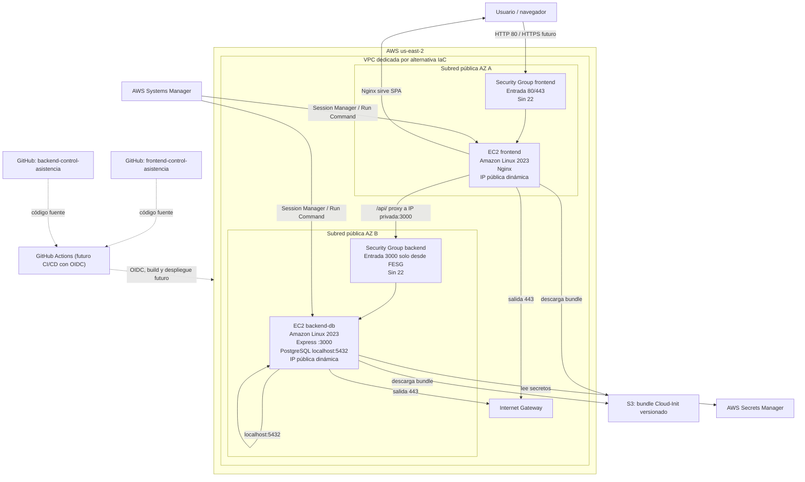

# Arquitectura de referencia

## 1. Objetivo

Desplegar la aplicación Control de Asistencia en AWS con dos instancias Amazon Linux 2023, manteniendo una separación clara entre el frontend público y el backend con PostgreSQL, sin NAT Gateway y sin SSH expuesto a Internet.

La arquitectura prioriza:

- Bajo costo operativo.
- Superficie de ataque reducida.
- Administración remota mediante AWS Systems Manager.
- Secretos fuera del código.
- Una única fuente de Cloud-Init para las tres alternativas de IaC.

## 2. Decisiones confirmadas

| Tema | Decisión |
| --- | --- |
| Proveedor | AWS |
| Región | `us-east-2` |
| Sistema operativo | Amazon Linux 2023 x86_64 |
| Frontend | EC2 en subred pública, Nginx, IP pública dinámica |
| Backend y PostgreSQL | EC2 en subred pública, IP pública dinámica, sin NAT Gateway |
| Puerto backend | TCP 3000, solo desde el Security Group del frontend |
| PostgreSQL | `localhost:5432`, sin exposición de red |
| Administración | AWS Systems Manager Session Manager |
| SSH | No habilitado |
| IMDS | IMDSv2 obligatorio |
| Runtime backend | Node.js 24 LTS |
| Base de datos | PostgreSQL 17 |
| Servidor web | Nginx |
| Build frontend | `VITE_API_URL=/api` |
| Zona horaria | `America/La_Paz` en SO, PostgreSQL y aplicación |
| Secretos | AWS Secrets Manager |
| Persistencia PostgreSQL | Volumen raíz de la instancia backend |
| Cloud-Init | Bundle versionado en S3 con checksum |

### Verificación de paquetes en Amazon Linux 2023

Amazon Linux 2023 ofrece paquetes versionados para las versiones elegidas:

- `nodejs24` (Node.js 24 LTS).
- `postgresql17`, `postgresql17-server` y `postgresql17-contrib`.
- `nginx`.

La disponibilidad fue contrastada con las notas de versión y la lista de paquetes de AL2023. Antes de implementar Cloud-Init se debe volver a verificar en la AMI y release exactos que se utilicen, porque las versiones de paquetes evolucionan.

Referencias:

- https://docs.aws.amazon.com/linux/al2023/release-notes/all-packages-AL2023.12.html
- https://docs.aws.amazon.com/linux/al2023/ug/nodejs.html

## 3. Diagrama

## 4. Red

### VPC y subredes

Cada alternativa de IaC utiliza una VPC independiente para evitar colisiones si se ejecutan por error en la misma cuenta:

| Alternativa | CIDR propuesto |
| --- | --- |
| Terraform | `10.10.0.0/16` |
| Pulumi | `10.20.0.0/16` |
| CloudFormation | `10.30.0.0/16` |

Los CIDR son una convención de esta etapa y deberán confirmarse antes de implementar. La estructura prevista es:

- Dos subredes públicas, una por zona de disponibilidad.
- `MapPublicIpOnLaunch` habilitado.
- Route table con `0.0.0.0/0` hacia Internet Gateway.
- Sin NAT Gateway.
- Sin subred privada, porque el backend necesita salida directa a Internet y no se quiere pagar NAT.

### Consecuencia de la IP pública del backend

El backend tiene IP pública para permitir actualizaciones, acceso a S3, Secrets Manager y SSM sin NAT Gateway. Sin embargo:

- No se publica la API en Internet.
- El Security Group del backend solo acepta TCP 3000 desde el Security Group del frontend.
- El frontend accede al backend por su IP privada, no por la pública.
- La IP pública del backend puede cambiar si se reemplaza la instancia.
- La IP pública del frontend también es dinámica; no se utiliza Elastic IP.

Esta es una decisión económica con una limitación de aislamiento de red que debe revisarse si el proyecto pasa a un entorno de producción con mayores requisitos.

## 5. Flujo de tráfico de aplicación

1. El usuario accede al frontend por HTTP en el puerto 80.
2. El Security Group del frontend permite 80 y 443 desde Internet.
3. Nginx sirve los archivos estáticos de la SPA.
4. Las rutas del frontend que no son archivos se resuelven con `try_files` hacia `index.html`.
5. Las solicitudes a `/api/` se proxyan a `http://<IP_PRIVADA_BACKEND>:3000`.
6. El Security Group del backend acepta el puerto 3000 únicamente desde el Security Group del frontend.
7. Express procesa la solicitud.
8. Express accede a PostgreSQL mediante `localhost:5432`.
9. PostgreSQL no acepta conexiones de red externas.

No hay balanceador de carga en esta etapa. La IP pública del frontend es dinámica y puede cambiar si la instancia se reemplaza.

## 6. Flujo de administración

1. El operador inicia una sesión de AWS Systems Manager Session Manager.
2. SSM se comunica con el agente de la instancia mediante salida HTTPS 443.
3. No se abre el puerto 22.
4. Las instancias usan un instance profile con permisos mínimos.
5. Los comandos de despliegue y diagnóstico se ejecutan mediante SSM Run Command o Session Manager.

El flujo de administración es independiente del tráfico de usuarios. No requiere exponer puertos de administración y no depende de la IP pública del frontend.

## 7. Flujo de secretos

1. La instancia backend obtiene credenciales temporales mediante su instance profile.
2. El agente de Cloud-Init y el servicio backend leen los secretos desde Secrets Manager con permisos limitados.
3. Los secretos se escriben en archivos locales con permisos `0600` o se cargan en el entorno del servicio.
4. Los valores no se escriben en el bundle S3, en Git ni en la user-data.
5. El frontend no necesita secretos de base de datos.

La contraseña inicial del administrador también se obtiene desde Secrets Manager. No debe quedar codificada en `schema.sql` ni en scripts.

## 8. Flujo de Cloud-Init

1. La implementación IaC crea la instancia con una user-data pequeña.
2. La user-data recibe el bucket, la clave, la versión y el checksum del bundle.
3. La user-data descarga el bundle desde S3 usando el instance profile.
4. Se verifica el checksum SHA-256.
5. Se extrae el bundle y se ejecuta `bootstrap.sh` con el rol `frontend` o `backend-db`.
6. Cloud-Init se ejecuta únicamente en el primer arranque.
7. Las actualizaciones posteriores de la aplicación se realizan mediante CI/CD y SSM, no recreando la instancia.

Ver [`03-cloud-init.md`](03-cloud-init.md).

## 9. Zona horaria

Se configura `America/La_Paz` de forma coherente en:

- Sistema operativo: `timedatectl set-timezone America/La_Paz`.
- PostgreSQL: `timezone = 'America/La_Paz'` en `postgresql.conf`.
- Aplicación: variable `TZ=America/La_Paz` y, si es necesario, opciones de conexión que fijen la zona horaria de la sesión.

El backend utiliza funciones de PostgreSQL como `CURRENT_DATE` y `LOCALTIME` para las ventanas de asistencia. Por eso la coherencia entre sistema operativo, base de datos y aplicación es un requisito funcional, no solo operativo.

## 10. Runtime y servicios

- **Frontend:** Nginx sirve la SPA. El build se genera con `VITE_API_URL=/api`.
- **Backend:** Node.js 24 LTS, Express, servicio systemd, puerto 3000.
- **Base de datos:** PostgreSQL 17, escucha en `localhost:5432`, extensiones `citext`, `pgcrypto` y `unaccent`.
- **Esquema:** se inicializa con `psql`; el proceso debe manejar `CREATE DATABASE` y `\connect` del archivo auditado.
- **Datos demo:** se conservan el módulo inicial, el administrador inicial y las fechas de demostración existentes. La contraseña del administrador se obtiene de Secrets Manager.

## 11. Persistencia y respaldo

PostgreSQL utiliza el volumen raíz de la instancia backend. No se crea un volumen EBS independiente.

Implicaciones:

- El volumen raíz debe tener capacidad suficiente para datos, WAL y logs.
- Se requiere una política de snapshots del volumen raíz.
- Se debe probar la restauración en una instancia temporal.
- Reemplazar la instancia sin un snapshot previo puede causar pérdida de datos.

Ver [`08-operacion-y-runbook.md`](08-operacion-y-runbook.md).

## 12. Alternativas independientes

Terraform, Pulumi y CloudFormation describen la misma arquitectura, pero son alternativas excluyentes:

- No deben desplegarse simultáneamente sobre los mismos recursos.
- No deben compartir VPC, subredes, Security Groups, instancias, nombres de secretos ni estados.
- Cada alternativa tiene su propio estado y su propio ciclo de vida.
- La fuente común es Cloud-Init, no el estado de IaC.

## 13. Fuera de alcance de la Etapa 2

- Crear recursos AWS.
- Publicar el bundle de Cloud-Init.
- Implementar los scripts funcionales de inicialización.
- Configurar HTTPS, dominio o certificados.
- Configurar backups automáticos.
- Configurar OIDC y roles de GitHub Actions.
- Desplegar frontend o backend.
